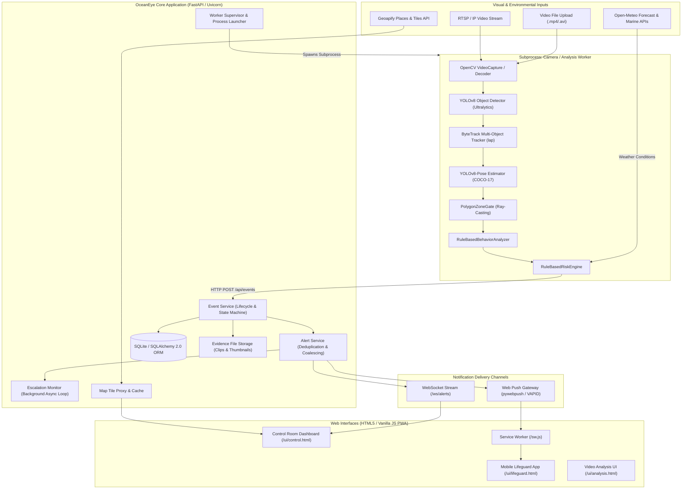
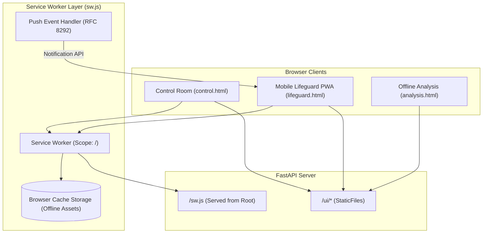
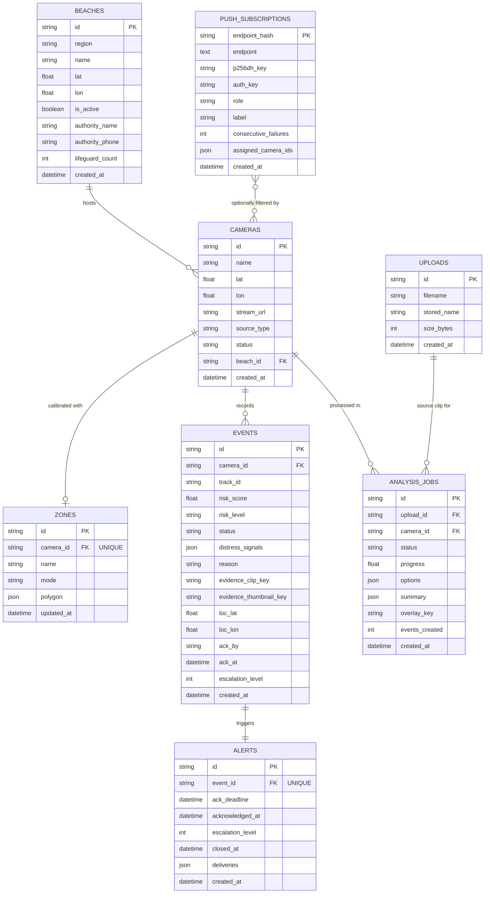

# OceanEye: Complete Technical Documentation & Architectural Reference

> **Document Version:** 1.0.0  
> **Target Release:** OceanEye 0.3.0  
> **Codebase Root:** `C:\pbl_oceaneye`  
> **Primary Technology Stack:** Python 3.10+, FastAPI, PyTorch, Ultralytics YOLOv8 / YOLOv8-Pose, ByteTrack, OpenCV, SQLAlchemy 2.0 (SQLite), Vanilla JS / HTML5 PWA, Web Push (VAPID / RFC 8292).

---

## Table of Contents
1. [Executive Summary & Purpose](#1-executive-summary--purpose)
2. [High-Level System Architecture](#2-high-level-system-architecture)
3. [Complete Directory & File Structure](#3-complete-directory--file-structure)
4. [Computer-Vision & Deep-Learning Pipeline](#4-computer-vision--deep-learning-pipeline)
5. [Exhaustive API Endpoint Reference](#5-exhaustive-api-endpoint-reference)
6. [Backend Business Logic & Process Model](#6-backend-business-logic--process-model)
7. [Frontend Architecture & Progressive Web Apps](#7-frontend-architecture--progressive-web-apps)
8. [Database Schema, ORM Models & Data Storage](#8-database-schema-orm-models--data-storage)
9. [Dependencies & Tooling Reference](#9-dependencies--tooling-reference)
10. [Configuration, Environment Variables & Security](#10-configuration-environment-variables--security)
11. [Installation, Operational Execution & Deployment](#11-installation-operational-execution--deployment)
12. [End-to-End Operational Workflows](#12-end-to-end-operational-workflows)
13. [Testing, Quality Assurance & Benchmarks](#13-testing-quality-assurance--benchmarks)
14. [Technical Glossary & Deep Concepts](#14-technical-glossary--deep-concepts)
15. [Interview & Project Defense Guide (25+ In-Depth Q&As)](#15-interview--project-defense-guide)

---

## 1. Executive Summary & Purpose

### 1.1 The Core Problem
Open-water coastal drowning is a rapid, silent crisis. In the vast majority of cases, drowning swimmers do **not** thrash their arms wildly or call for help because the human respiratory system prioritizes breathing over vocalization (the *Instinctive Drowning Response*, as characterized by Dr. Frank Pia). Swimmers in distress quietly slip underwater within 20 to 60 seconds.

On vast public ocean beaches (such as Tannirbhavi Beach in Mangaluru, Karnataka), human lifeguards face severe physical constraints:
* **Glare, Heat, & Fatigue:** Watching glistening ocean water for hours causes rapid vigilance decrement.
* **Line-of-Sight Blockages & Distance:** Swimmers caught in rip currents can be hundreds of meters away from lifeguard watchtowers.
* **Delayed Emergency Response:** A drowning incident unobserved for even 30 seconds often leads to irreversible hypoxic brain injury or fatal submersion.

### 1.2 The OceanEye Solution
**OceanEye** is an edge-optimized, AI-assisted drowning-risk detection and response coordination system. It transforms standard beach CCTV / IP camera streams or recorded drone video feeds into intelligent coastal safety sensors.

OceanEye operates on an **interpretable, hybrid AI + heuristic safety architecture**:
1. **Visual Perception:** Deep learning models (**YOLOv8** for person detection and **YOLOv8-Pose** for skeletal landmark estimation) identify human bodies in the water.
2. **Multi-Object Tracking:** **ByteTrack** maintains continuous identity across bounding boxes despite wave occlusions, splashes, and camera jitter.
3. **Danger Zone Gating:** Normalised polygon gates isolate rip currents, deep water trenches, and rocky reefs using ray-casting algorithms.
4. **Behavioral Distress Analytics:** Deterministic temporal heuristics evaluate physical distress cues:
   * *Prolonged Stillness* (unconscious floater / exhaustion)
   * *Vertical Bobbing* (active surface struggle)
   * *Erratic Motion* (panic swims against currents)
   * *Repeated Submersion* (head/body slipping beneath waterline)
   * *Vertical Torso in Water* (instinctive upright posture, no forward propulsion)
   * *Arms Raised* (wrist breach above shoulder waterline)
5. **Multi-Channel Alert Dispatch & Escalation:** Candidate risk events trigger sub-second WebSocket updates to the Control Room, push audible alarm notifications to mobile lifeguard PWAs via encrypted Web Push (VAPID), and execute automatic supervisor escalation if unacknowledged within a configurable deadline (default 30 seconds).

---

## 2. High-Level System Architecture

OceanEye is structured as a **modular monolith** adhering to Clean Architecture and Hexagonal (Ports & Adapters) design principles. Subsystems are bounded by strict domain interfaces, preventing vendor lock-in and allowing individual perception stages to be mocked, upgraded, or executed across multi-core processes.



### 2.1 Communication Sequence: Distress to Dispatch
The diagram below details the exact chronological sequence when a swimmer exhibits distress signs inside a defined danger zone:

```mermaid
sequenceDiagram
    autonumber
    actor Swimmer
    participant Camera as RTSP / Video Source
    participant Worker as Worker Subprocess (session.py)
    participant API as FastAPI Backend (events/alerts)
    participant DB as SQLite Database
    participant Push as Web Push Gateway (VAPID)
    participant Guard as Lifeguard Mobile PWA

    Camera->>Worker: Delivers raw frame (BGR)
    Worker->>Worker: YOLOv8 detects person bbox
    Worker->>Worker: ByteTrack assigns persistent Track ID
    Worker->>Worker: PolygonZoneGate confirms: inside danger zone
    Worker->>Worker: BehaviorAnalyzer evaluates: Vertical Torso + Submersion
    Worker->>Worker: RiskEngine: Score = 0.88 >= 0.70 threshold for 3.2s
    Worker->>API: POST /api/events (Candidate Event + Evidence B64)
    API->>DB: Persist EventModel & AlertModel (Deadline = Now + 30s)
    API->>API: Coalesce active track duplicate alerts (D9)
    par Real-Time Control Room Broadcast
        API->>Guard: WebSocket /ws/alerts -> Render Red Banner & Audio Beep
    and Encrypted Background Notification
        API->>Push: Encrypt payload via RFC 8292 (p256dh + auth keys)
        Push->>Guard: Deliver Web Push Notification (Wakes Service Worker)
    end
    Guard->>Guard: Service Worker shows system notification + vibrates
    Guard->>API: POST /api/events/{id}/ack (Lifeguard confirms)
    API->>DB: Update Event status='acknowledged', record ack_by
    API->>Worker: Status update propagated; escalation timer disarmed
```

---

## 3. Complete Directory & File Structure

```text
C:\pbl_oceaneye
├── app/                                # Core Application Root
│   ├── alerts/                         # Alert Lifecycle, Escalation, & Dispatch
│   │   ├── api/
│   │   │   ├── push.py                 # Web Push subscription, test push, device management
│   │   │   ├── router.py               # Alert listing and retrieval endpoints
│   │   │   └── schemas.py              # Pydantic schemas for alert responses
│   │   ├── escalation/
│   │   │   ├── base.py                 # Escalation interfaces
│   │   │   ├── monitor.py              # Background async loop checking overdue ACKs
│   │   │   └── service.py              # Escalation execution & notifications
│   │   ├── notifications/
│   │   │   ├── base.py                 # NotificationProvider interface
│   │   │   ├── composite.py            # Fan-out dispatcher to multiple channels
│   │   │   ├── mock.py                 # In-memory notification sink for unit tests
│   │   │   ├── web_push.py             # PyWebPush VAPID implementation
│   │   │   └── websocket.py            # Local WebSocket notification dispatcher
│   │   ├── handlers.py                 # Event handlers converting events to alerts
│   │   └── services/
│   │       ├── alert_service.py        # Central AlertService (Deduplication, ACK, build_payload)
│   │       └── base.py                 # AlertService interface
│   ├── camera/                         # Camera Domain & Management
│   │   ├── api/
│   │   │   ├── router.py               # Camera registration and listing endpoints
│   │   │   └── schemas.py              # Camera request/response validation schemas
│   │   ├── domain/entities.py          # Camera entity value objects
│   │   └── services/camera_service.py  # Camera business logic and coordinate handling
│   ├── config/
│   │   └── settings.py                 # Central Pydantic Settings (OCEANEYE_* variables)
│   ├── core/                           # Domain Core (Enterprise Business Rules)
│   │   ├── domain/value_objects.py     # Polygon, Location, BoundingBox value types
│   │   ├── entities/                   # Event, Alert, Beach, PushSubscription entities
│   │   ├── enums/                      # RiskLevel, EventStatus, Role, CameraSourceType
│   │   ├── exceptions/                 # DomainValidationError, NotFoundError, ConflictError
│   │   └── interfaces/                 # Clock, Repositories, EventBus interfaces
│   ├── environment/                    # Coastal Environment, Weather, & Danger Zones
│   │   ├── api/
│   │   │   ├── router.py               # Beach sites, place search, weather endpoints
│   │   │   ├── schemas.py              # Weather, Beach, and Zone schemas
│   │   │   └── tiles.py                # Geoapify tile proxy & memory cache
│   │   ├── beaches/service.py          # Beach site management and active site selection
│   │   ├── external_data/              # Open-Meteo & Geoapify API clients
│   │   └── zones/
│   │       ├── gate.py                 # Point-in-polygon ray-casting gate
│   │       └── service.py              # Static & dynamic danger zone persistence
│   ├── events/                         # Candidate Risk Events Subsystem
│   │   ├── api/
│   │   │   ├── router.py               # Event creation, listing, ACK, escalation, outcome
│   │   │   └── schemas.py              # Event Pydantic schemas
│   │   ├── domain/commands.py          # NewEventCommand, AcknowledgeCommand
│   │   └── services/event_service.py   # State transitions and lifecycle rules
│   ├── evidence/                       # Forensic Evidence Subsystem
│   │   ├── api/router.py               # Protected clip & thumbnail streaming endpoint
│   │   └── storage.py                  # Local disk storage for evidence artifacts
│   ├── main/                           # Application Factory & Startup Lifespan
│   │   ├── asgi.py                     # ASGI entrypoint for Uvicorn
│   │   ├── container.py                # Dependency Injection Container wiring
│   │   ├── error_handlers.py           # Exception handlers mapping domain errors to HTTP
│   │   ├── factory.py                  # FastAPI app creation, middleware, route mounting
│   │   ├── health.py                   # /health (liveness) and /ready (readiness) probes
│   │   └── middleware.py               # Request context & tracing middleware
│   ├── persistence/                    # Database Infrastructure (SQLAlchemy 2.0)
│   │   ├── database/                   # Database engine, session maker, custom types
│   │   ├── models/                     # SQLAlchemy ORM mapped models (8 tables)
│   │   └── repositories/               # Concrete repository implementations
│   ├── processing/                     # Video Uploads, Offline Jobs & Worker Supervision
│   │   ├── api/router.py               # /uploads, /analysis/jobs, /live/cameras endpoints
│   │   ├── live_state.py               # In-memory buffer of latest camera frames & stats
│   │   ├── service.py                  # Job lifecycle, worker command resolution
│   │   └── supervisor.py               # Subprocess launcher, monitoring & teardown
│   ├── risk/                           # Aquatic Distress & Scoring Engine
│   │   ├── distress/
│   │   │   ├── base.py                 # BehaviorAnalyzer interfaces
│   │   │   └── rules.py                # 6 distress heuristics (Stillness, Bobbing, Erratic, Submersion, Vertical, Arms)
│   │   ├── engine/
│   │   │   ├── base.py                 # RiskEngine interfaces & RiskAssessment data class
│   │   │   └── rules.py                # Multi-signal weighted risk engine with persistence
│   │   └── scoring/config.py           # Tuned thresholds, weights, and time windows
│   ├── security/                       # Authentication & Role-Based Access Control
│   │   ├── authentication.py           # Authenticator supporting dev headers and bearer tokens
│   │   ├── authorization.py            # Role hierarchies (admin, management, responder, service)
│   │   ├── dependencies.py             # FastAPI dependency guards (require_roles)
│   │   └── middleware.py               # Security headers (HSTS, CSP, X-Frame-Options)
│   ├── shared/                         # Shared Cross-Cutting Utilities
│   │   ├── dependencies.py             # Reusable FastAPI dependency resolvers
│   │   ├── hardware.py                 # GPU/CPU probe & worker auto-tuning logic
│   │   └── logging_setup.py            # Structured JSON / ANSI console logging setup
│   ├── vision/                         # Computer Vision Components
│   │   ├── detection/yolo.py           # Ultralytics YOLOv8 detector wrapper
│   │   ├── media.py                    # OpenCV VideoCapture wrapper with reconnection
│   │   ├── pipeline/default.py         # Sequential CV pipeline execution
│   │   ├── pose/yolo_pose.py           # Ultralytics YOLOv8-Pose COCO-17 wrapper
│   │   ├── profiles.py                 # Hardware execution profiles (CPU/GPU, resolutions)
│   │   ├── tracking/bytetrack.py       # ByteTrack association implementation
│   │   └── visualization/draw.py       # OpenCV annotation (boxes, skeletons, zones)
│   ├── web/static/                     # Zero-Build HTML5 / Vanilla JS Frontend
│   │   ├── control.html                # Operator Control Room (Map, CCTV, Alerts)
│   │   ├── lifeguard.html              # Mobile PWA for responding lifeguards
│   │   ├── analysis.html               # Offline video analysis & playback UI
│   │   ├── sw.js                       # Service Worker for offline PWA & Web Push
│   │   └── js/
│   │       ├── api.js                  # Shared API client & WebSocket wrapper
│   │       ├── control.js              # Control room state management & Leaflet map
│   │       └── lifeguard.js            # Lifeguard audio sirens, haptics & ACK logic
│   ├── websocket/                      # Real-Time WebSocket Infrastructure
│   │   ├── manager.py                  # Client connection registry & filtering
│   │   └── router.py                   # /ws/alerts endpoint
│   └── worker/                         # Standalone Worker Subprocess Implementation
│       ├── cli.py                      # Subprocess CLI entrypoint
│       ├── session.py                  # WorkerSession pipeline loop, FPS pacing, push callbacks
│       └── sinks.py                    # Evidence clip recorder & frame encoders
├── scripts/                            # Operational & Benchmarking CLI Tools
│   ├── evaluate_detection.py           # Ground-truth evaluation script
│   ├── make_certs.py                   # Self-signed SAN TLS certificate generator
│   ├── make_push_keys.py               # VAPID keypair generator
│   ├── run_api.py                      # Server launcher with LAN discovery
│   ├── run_clip_matrix.py              # Automated model & stride benchmark grid
│   ├── seed_demo.py                    # Database seeder with Tannirbhavi Beach & demo stream
│   ├── simulate_camera.py              # Headless simulated RTSP/file camera streamer
│   └── test_push.py                    # Out-of-band push notification testing script
├── tests/                              # Comprehensive Test Suite
│   ├── hardening/                      # 30 Synthetic Hardening Tests (D1–D9 Defect Verification)
│   │   ├── conftest.py                 # Deterministic synthetic fixtures
│   │   ├── synth.py                    # Swimmer trajectory & pose synthesis generator
│   │   ├── test_behaviour_rules.py     # Rule-level tests (submersion, bobbing, stillness, pose)
│   │   └── test_pipeline_and_alerts.py # Integration tests (worker pipeline, dedup, timestamps)
│   ├── unit/                           # Unit tests for domain models, security, and utils
│   └── integration/                    # API integration tests via TestClient
└── pyproject.toml                      # Project metadata, dependencies, & pytest config
```

---

## 4. Computer-Vision & Deep-Learning Pipeline

OceanEye's perception engine is completely decoupled from the HTTP web process. When monitoring a camera or processing an uploaded video, the backend launches an independent worker subprocess ([`app/worker/session.py`](file:///c:/pbl_oceaneye/app/worker/session.py)) running the pipeline at a controlled target frame rate.

```mermaid
flowchart LR
    Frame["Input Frame (OpenCV BGR)"] --> Pre["Resize & Letterbox (imgsz)"]
    Pre --> YOLO["YOLOv8 Person Detection"]
    YOLO -->|Filter: Class 0, Conf >= 0.25| BBoxes["Person Bounding Boxes"]
    BBoxes --> ByteTrack["ByteTrack Association (lap)"]
    ByteTrack -->|Tracks with History| Pose["YOLOv8-Pose (Optional)"]
    Pose -->|COCO-17 Keypoints| Zone["PolygonZoneGate"]
    Zone -->|Inside / Outside Status| Behav["Behavior Heuristics"]
    Behav -->|Signals Raised| Risk["Weighted Risk Scoring"]
    Risk -->|Score >= 0.70 & Sustained| Event["Candidate Event Raised"]
```



### 4.1 Stage 1: Input Ingestion & Preprocessing
* **Sources:** Handled by [`app/vision/media.py`](file:///c:/pbl_oceaneye/app/vision/media.py). Supports local files (`.mp4`, `.avi`, `.mkv`), RTSP/RTSPS streams, HTTP/HTTPS MJPEG endpoints, and local webcams (`source_type="camera"`).
* **Auto-Reconnection:** RTSP streams incorporate exponential backoff retry logic. If a connection drops, the reader sleeps briefly and reinstantiates the `cv2.VideoCapture` object without crashing the worker process.
* **Frame Downsampling & Striding:** High-resolution cameras (1080p / 4K) are resized to the worker's target inference size (`imgsz`, typically `640` or `960`). Input frame rates (e.g. 30 FPS) are strided down to the target analysis rate (typically 3 to 10 FPS) to prevent computational saturation.

### 4.2 Stage 2: Object Detection (Ultralytics YOLOv8)
* **Model:** YOLOv8 (nano `yolov8n.pt`, small `yolov8s.pt`, or custom fine-tuned weights). Implemented in [`app/vision/detection/yolo.py`](file:///c:/pbl_oceaneye/app/vision/detection/yolo.py).
* **Filtering:** Only detections matching **Class `0` (`person`)** are retained. All other classes (boats, surfboards, buoys, birds) are discarded immediately.
* **Sensitivity Profiles:**
  * `low`: Confidence threshold `0.35`, NMS IoU `0.50`
  * `medium`: Confidence threshold `0.25`, NMS IoU `0.45` (default)
  * `high`: Confidence threshold `0.15`, NMS IoU `0.40`
* **Coordinate Space:** Bounding boxes are stored as normalised floating-point coordinates `(x_min, y_min, x_max, y_max) \in [0.0, 1.0]` relative to frame width and height, ensuring spatial invariant calculations across different resolutions.

### 4.3 Stage 3: Multi-Object Tracking (ByteTrack)
* **Algorithm:** ByteTrack, implemented in [`app/vision/tracking/bytetrack.py`](file:///c:/pbl_oceaneye/app/vision/tracking/bytetrack.py) using `lap` (Linear Assignment Problem solver).
* **Mechanism:** Maintains tracking consistency by associating both high-confidence and low-confidence detections across consecutive frames using Kalman filters and IoU distance matrices:
  1. *First Association:* High-score detections ($conf \ge 0.5$) are matched with existing confirmed tracks.
  2. *Second Association:* Unmatched tracks are associated with low-score detections ($0.1 \le conf < 0.5$). This recovers swimmers temporarily obscured by breaking wave crests, spray, or camera roll without re-allocating new track IDs.
* **History Window:** Each confirmed track retains a temporal ring buffer of its past bounding boxes and timestamps.

### 4.4 Stage 4: Skeletal Pose Estimation (YOLOv8-Pose)
* **Model:** YOLOv8-Pose (`yolov8n-pose.pt`), implemented in [`app/vision/pose/yolo_pose.py`](file:///c:/pbl_oceaneye/app/vision/pose/yolo_pose.py).
* **Keypoints Extracted:** 17 COCO keypoints:
  `[nose, left_eye, right_eye, left_ear, right_ear, left_shoulder, right_shoulder, left_elbow, right_elbow, left_wrist, right_wrist, left_hip, right_hip, left_knee, right_knee, left_ankle, right_ankle]`.
* **Execution:** Enabled when hardware permits (`pose=True`). Pose estimation is executed on the cropped bounding-box regions of tracked swimmers. If a swimmer is too distant or heavily submerged, missing keypoints return `None`, treated by the downstream engine as *unknown*, never as *safe*.

### 4.5 Stage 5: Danger Zone Gating
* **Implementation:** [`app/environment/zones/gate.py`](file:///c:/pbl_oceaneye/app/environment/zones/gate.py).
* **Algorithm:** Ray-casting point-in-polygon algorithm.
* **Anchor Point:** Standardized to the **bottom-center** of the swimmer's bounding box:
  $$\text{Anchor} = \left( \frac{x_{\min} + x_{\max}}{2}, \; y_{\max} \right)$$
  *Rationale:* The bottom of the bounding box represents the swimmer's waterline contact point. Using the geometric center `(x_center, y_center)` causes swimmers standing near the outer boundary to toggle in and out of the danger zone as waves lift them.

### 4.6 Stage 6: Behavioral Distress Heuristics (Rule-Based)
Implemented in [`app/risk/distress/rules.py`](file:///c:/pbl_oceaneye/app/risk/distress/rules.py).
Before evaluating distress, each track must pass **Three Rigorous Gates**:
1. **Maturity Gate:** Track age $\ge 2.0\text{s}$ (`min_track_seconds`). Filters out transient false detections, wave froth, and glint.
2. **Resolution Gate:** Swimmer peak visible height $\ge 20\text{ pixels}$ (`min_body_pixels`). Measurements on tiny pixel clusters produce extreme noise and are discarded.
3. **Sampling Density Gate:** Effective track sampling rate $\ge 0.8\text{ Hz}$ (`min_sample_rate_hz`). Prevents frame drops from masquerading as stillness.

#### The 6 Distress Signals:
1. **Prolonged Stillness (`prolonged_stillness`, Weight: `0.30`):**
   * *Criterion:* Total bounding box movement across 8 seconds is $< 0.45$ body-heights.
   * *Formula:*
     $$\text{spread} = \frac{\sqrt{(\max(x) - \min(x))^2 + (\max(y) - \min(y))^2}}{\text{peak\_body\_height}} < 0.45$$
   * *Detection:* Unconscious floating, severe cramps, hypothermic paralysis.
2. **Vertical Bobbing (`vertical_bobbing`, Weight: `0.35`):**
   * *Criterion:* Vertical oscillations with amplitude $\ge 0.035$ body-heights and $\ge 2$ direction reversals within a 6.0s window, while horizontal drift remains low ($< 0.65$ body-heights).
   * *Detection:* Active surface struggle to keep head above water.
3. **Erratic Movement (`erratic_movement`, Weight: `0.25`):**
   * *Criterion:* High-velocity directional shifts where $> 45\%$ of consecutive vectors turn $> 65^\circ$.
   * *Anti-Jitter Filter:* Consecutive bounding boxes are subsampled at $\Delta t \ge 0.25\text{s}$. This prevents high-FPS detector bounding-box noise from simulating rapid swimmer turns.
   * *Detection:* Panic swimming against rip currents or disorientation.
4. **Repeated Submersion (`repeated_submersion`, Weight: `0.40`):**
   * *Criterion:* Swimmer bounding-box height collapses below $72\%$ (`shrink_ratio = 0.72`) of their baseline peak height $\ge 2$ times, or stays continuously submerged for $\ge 3$ consecutive frames.
   * *Baseline Denominator:* Evaluated against $\max(y_{\max} - y_{\min})$ across the entire track history. This prevents the baseline from shrinking as the swimmer sinks deeper.
   * *Gap Filter:* Interval between frames must be $\le 1.2\text{s}$ (`gap_seconds = 1.2`).
5. **Vertical in Water (`vertical_in_water`, Weight: `0.55`, Requires Pose):**
   * *Criterion:* Shoulder-to-hip vector is within $28^\circ$ of vertical, observed for $\ge 2.5\text{s}$ with total drift $< 0.80$ body-heights.
   * *Significance:* This is the clinical hallmark of the *Instinctive Drowning Response*. Swimmers actively swimming or floating maintain a horizontal torso axis ($45^\circ - 90^\circ$). Upright posture without forward movement indicates the victim is attempting to "climb an invisible ladder."
6. **Arms Raised (`arms_raised`, Weight: `0.45`, Requires Pose):**
   * *Criterion:* One or both wrists rise above the shoulder line by at least $0.40 \times \text{head\_height}$.
   * *Significance:* Distress waving or flailing before complete exhaustion.

### 4.7 Stage 7: Risk Scoring & Temporal Persistence
Implemented in [`app/risk/engine/rules.py`](file:///c:/pbl_oceaneye/app/risk/engine/rules.py).

$$\text{Raw Score} = \min\left(1.0, \; \sum_{i} \left(w_i \cdot \text{confidence}_i\right) \times Z \times E \right)$$

Where:
* $w_i$: Signal weight from [`RiskScoringConfig`](file:///c:/pbl_oceaneye/app/risk/scoring/config.py)
* $Z$: Zone factor ($1.0$ if inside danger zone or no zone set; $0.20$ if outside danger zone)
* $E$: Environmental factor ($1.15$ if marine waves $\ge 1.5\text{m}$ or wind $\ge 10\text{m/s}$; otherwise $1.0$)

#### Actionability Threshold & Persistence:
* A score is classified into discrete risk levels:
  * **LOW:** $0.00 \le \text{Score} < 0.35$
  * **MEDIUM:** $0.35 \le \text{Score} < 0.55$
  * **HIGH:** $0.55 \le \text{Score} < 0.70$
  * **CRITICAL:** $0.70 \le \text{Score} \le 1.00$
* **Event Actionability Rule:** To raise a candidate event, the risk score must remain $\ge 0.70$ (`alert_threshold`) continuously for **$\ge 3.0\text{ seconds}$** (`persistence_seconds`). Transient splashes or single-frame anomalies do not produce alerts.
* **Rate Limits:** Maximum 3 events per minute per camera; 30-second cooldown per individual track ID.

---

## 5. Exhaustive API Endpoint Reference

Every route in the OceanEye backend is listed below. All routes are prefixed with `/api` except where noted.

### 5.1 System & Health Probes
| Method | Endpoint | Auth | Request Body | Response Codes | Description & Source |
|---|---|---|---|---|---|
| `GET` | `/health` | None | None | `200 OK` | **Liveness Probe:** Returns `{"status":"ok"}`. Process is alive. ([`app/main/health.py:11`](file:///c:/pbl_oceaneye/app/main/health.py#L11)) |
| `GET` | `/ready` | None | None | `200 OK`, `503 Unavailable` | **Readiness Probe:** Checks database and evidence storage connectivity. ([`app/main/health.py:17`](file:///c:/pbl_oceaneye/app/main/health.py#L17)) |

### 5.2 Cameras & Video Stream Management
| Method | Endpoint | Auth | Request Body | Response Codes | Description & Source |
|---|---|---|---|---|---|
| `POST` | `/api/cameras` | Management | `CameraCreate` | `201 Created`, `400`, `404` | **Register Camera:** Creates camera record and attaches danger zone. Validates stream URL scheme and beach ID. ([`app/camera/api/router.py:18`](file:///c:/pbl_oceaneye/app/camera/api/router.py#L18)) |
| `GET` | `/api/cameras` | Responder | Query: `beach_id` | `200 OK` | **List Cameras:** Returns all registered cameras or filters by beach deployment. ([`app/camera/api/router.py:46`](file:///c:/pbl_oceaneye/app/camera/api/router.py#L46)) |

### 5.3 Candidate Events & Operator Lifeguard Workflow
| Method | Endpoint | Auth | Request Body | Response Codes | Description & Source |
|---|---|---|---|---|---|
| `POST` | `/api/events` | Service / Producer | `EventCreate` | `201 Created`, `422` | **Raise Candidate Event:** Ingests an event raised by vision worker. Triggers alert generation. ([`app/events/api/router.py:30`](file:///c:/pbl_oceaneye/app/events/api/router.py#L30)) |
| `GET` | `/api/events` | Responder | Query filters | `200 OK` | **List Events:** Filter by `camera_id`, `status`, `started_after`, `limit`, `offset`. ([`app/events/api/router.py:45`](file:///c:/pbl_oceaneye/app/events/api/router.py#L45)) |
| `GET` | `/api/events/{event_id}` | Responder | Path: `event_id` | `200 OK`, `404` | **Get Event Details:** Fetches event state, risk score, evidence keys, and audit logs. ([`app/events/api/router.py:60`](file:///c:/pbl_oceaneye/app/events/api/router.py#L60)) |
| `POST` | `/api/events/{event_id}/ack` | Responder | `AckRequest` | `200 OK`, `404`, `409` | **Acknowledge Alert:** Lifeguard acknowledges alert. Disarms escalation timer. ([`app/events/api/router.py:66`](file:///c:/pbl_oceaneye/app/events/api/router.py#L66)) |
| `POST` | `/api/events/{event_id}/escalate`| Responder | `EscalateRequest` | `200 OK`, `404` | **Manual Escalation:** Operator manually escalates incident to supervisor. ([`app/events/api/router.py:75`](file:///c:/pbl_oceaneye/app/events/api/router.py#L75)) |
| `POST` | `/api/events/{event_id}/outcome` | Responder | `OutcomeRequest` | `200 OK`, `404` | **Close Loop Outcome:** Records resolution (`resolved` or `false_alarm`) and notes. ([`app/events/api/router.py:85`](file:///c:/pbl_oceaneye/app/events/api/router.py#L85)) |

### 5.4 Alerts & Web Push Subscriptions
| Method | Endpoint | Auth | Request Body | Response Codes | Description & Source |
|---|---|---|---|---|---|
| `GET` | `/api/alerts` | Responder | Query: `active_only` | `200 OK` | **List Active Alerts:** Returns current active alerts with deadlines and payloads. ([`app/alerts/api/router.py:18`](file:///c:/pbl_oceaneye/app/alerts/api/router.py#L18)) |
| `GET` | `/api/alerts/{alert_id}` | Responder | Path: `alert_id` | `200 OK`, `404` | **Get Alert:** Retrieves single alert record. ([`app/alerts/api/router.py:25`](file:///c:/pbl_oceaneye/app/alerts/api/router.py#L25)) |
| `GET` | `/api/push/public-key` | Responder | None | `200 OK`, `404` | **Get VAPID Key:** Returns server's public VAPID key for browser push subscription. ([`app/alerts/api/push.py:53`](file:///c:/pbl_oceaneye/app/alerts/api/push.py#L53)) |
| `POST` | `/api/push/subscribe` | Responder | `SubscriptionIn` | `201 Created`, `501` | **Register Web Push:** Registers browser push subscription (`endpoint`, `p256dh`, `auth`). ([`app/alerts/api/push.py:66`](file:///c:/pbl_oceaneye/app/alerts/api/push.py#L66)) |
| `POST` | `/api/push/unsubscribe` | Responder | `SubscriptionIn` | `204 No Content` | **Unsubscribe Device:** Removes endpoint from push notification registry. ([`app/alerts/api/push.py:88`](file:///c:/pbl_oceaneye/app/alerts/api/push.py#L88)) |
| `GET` | `/api/push/devices` | Responder | None | `200 OK` | **List Devices:** Lists registered devices (hashes and labels; raw endpoints redacted). ([`app/alerts/api/push.py:96`](file:///c:/pbl_oceaneye/app/alerts/api/push.py#L96)) |
| `POST` | `/api/push/test` | Responder | None | `200 OK`, `501` | **Send Test Push:** Dispatches out-of-band test push to verify phone wakeups. ([`app/alerts/api/push.py:108`](file:///c:/pbl_oceaneye/app/alerts/api/push.py#L108)) |
| `DELETE`| `/api/push/devices/{hash}`| Admin | Path: `hash` | `204 No Content` | **Forget Device:** Deletes device registration by hash. ([`app/alerts/api/push.py:133`](file:///c:/pbl_oceaneye/app/alerts/api/push.py#L133)) |

### 5.5 Forensic Evidence Retrieval
| Method | Endpoint | Auth | Request Body | Response Codes | Description & Source |
|---|---|---|---|---|---|
| `GET` | `/api/evidence/{event_id}/{kind}`| Responder | Path: `kind` (`clip`/`thumbnail`)| `200 OK`, `404` | **Stream Evidence:** Streams forensic MP4 clip or JPEG thumbnail. Not publicly exposed. ([`app/evidence/api/router.py:21`](file:///c:/pbl_oceaneye/app/evidence/api/router.py#L21)) |

### 5.6 Environment, Beaches, Danger Zones, & Map Proxy
| Method | Endpoint | Auth | Request Body | Response Codes | Description & Source |
|---|---|---|---|---|---|
| `GET` | `/api/zones/{camera_id}` | Human / Service | Path: `camera_id` | `200 OK`, `404` | **Get Danger Zone:** Fetches active polygon coordinates for a camera. ([`app/environment/api/router.py:39`](file:///c:/pbl_oceaneye/app/environment/api/router.py#L39)) |
| `PUT` | `/api/zones/{camera_id}` | Management | `ZoneUpdate` | `200 OK`, `400` | **Configure Danger Zone:** Updates normalised polygon boundary for camera view. ([`app/environment/api/router.py:50`](file:///c:/pbl_oceaneye/app/environment/api/router.py#L50)) |
| `GET` | `/api/places/search` | Human | Query: `q`, `lat`, `lon` | `200 OK` | **Search Places:** Free-text beach/place lookup powered by Geoapify. ([`app/environment/api/router.py:59`](file:///c:/pbl_oceaneye/app/environment/api/router.py#L59)) |
| `GET` | `/api/places/beaches-near`| Human | Query: `lat`, `lon`, `radius` | `200 OK` | **Nearby Beaches:** Searches beaches within radius km. ([`app/environment/api/router.py:76`](file:///c:/pbl_oceaneye/app/environment/api/router.py#L76)) |
| `GET` | `/api/beaches` | Human | None | `200 OK` | **List Beach Sites:** Lists configured deployment beaches. ([`app/environment/api/router.py:89`](file:///c:/pbl_oceaneye/app/environment/api/router.py#L89)) |
| `GET` | `/api/beaches/active` | Human | None | `200 OK`, `404` | **Active Beach:** Returns current active beach deployment site. ([`app/environment/api/router.py:95`](file:///c:/pbl_oceaneye/app/environment/api/router.py#L95)) |
| `POST` | `/api/beaches` | Management | `BeachSiteCreate` | `201 Created` | **Create Beach Site:** Onboards a new beach deployment. ([`app/environment/api/router.py:103`](file:///c:/pbl_oceaneye/app/environment/api/router.py#L103)) |
| `PATCH` | `/api/beaches/{beach_id}` | Management | `BeachSiteUpdate` | `200 OK` | **Update Beach:** Modifies authority contact, coordinates, or notes. ([`app/environment/api/router.py:112`](file:///c:/pbl_oceaneye/app/environment/api/router.py#L112)) |
| `POST` | `/api/beaches/{beach_id}/activate`| Admin | Path: `beach_id` | `200 OK` | **Activate Beach:** Designates the active beach site. ([`app/environment/api/router.py:120`](file:///c:/pbl_oceaneye/app/environment/api/router.py#L120)) |
| `GET` | `/api/weather` | Human / Service | Query: `lat`, `lon` | `200 OK` | **Marine Weather:** Proxies Open-Meteo forecast and marine wave heights with 10m TTL cache. ([`app/environment/api/router.py:129`](file:///c:/pbl_oceaneye/app/environment/api/router.py#L129)) |
| `GET` | `/api/map/tiles/{style}/{z}/{x}/{y}.png` | None (Public) | Path parameters | `200 OK` | **Map Tile Proxy:** Proxies Geoapify tiles server-side to hide API key. Returns transparent 1x1 PNG on error. ([`app/environment/api/tiles.py:48`](file:///c:/pbl_oceaneye/app/environment/api/tiles.py#L48)) |

### 5.7 Video Processing, Live Monitoring, & Demo
| Method | Endpoint | Auth | Request Body | Response Codes | Description & Source |
|---|---|---|---|---|---|
| `POST` | `/api/uploads` | Management | Multipart file | `201 Created`, `413` | **Upload Video Clip:** Uploads recorded MP4/AVI clip (up to 500MB). ([`app/processing/api/router.py:48`](file:///c:/pbl_oceaneye/app/processing/api/router.py#L48)) |
| `GET` | `/api/uploads` | Management | None | `200 OK` | **List Uploads:** Returns stored uploaded clips. ([`app/processing/api/router.py:53`](file:///c:/pbl_oceaneye/app/processing/api/router.py#L53)) |
| `DELETE`| `/api/uploads/{id}` | Management | Path: `id` | `204 No Content`, `409` | **Delete Upload:** Deletes clip file (refuses 409 if active job uses it). ([`app/processing/api/router.py:95`](file:///c:/pbl_oceaneye/app/processing/api/router.py#L95)) |
| `POST` | `/api/analysis/jobs` | Management | `JobCreate` | `201 Created` | **Submit Analysis Job:** Spawns offline worker to analyze video. ([`app/processing/api/router.py:58`](file:///c:/pbl_oceaneye/app/processing/api/router.py#L58)) |
| `GET` | `/api/analysis/jobs` | Management | Query: `limit` | `200 OK` | **List Jobs:** Retrieves batch video analysis jobs and statuses. ([`app/processing/api/router.py:64`](file:///c:/pbl_oceaneye/app/processing/api/router.py#L64)) |
| `GET` | `/api/analysis/jobs/{id}`| Management | Path: `id` | `200 OK`, `404` | **Get Job Details:** Job status, progress percentage, summary metrics. ([`app/processing/api/router.py:70`](file:///c:/pbl_oceaneye/app/processing/api/router.py#L70)) |
| `POST` | `/api/analysis/jobs/{id}/cancel`| Management | Path: `id` | `200 OK` | **Cancel Job:** Terminates background analysis subprocess. ([`app/processing/api/router.py:75`](file:///c:/pbl_oceaneye/app/processing/api/router.py#L75)) |
| `GET` | `/api/analysis/jobs/{id}/video`| Responder | Path: `id` | `200 OK` | **Download Overlay Video:** Streams MP4 with annotated bounding boxes and tracks. ([`app/processing/api/router.py:102`](file:///c:/pbl_oceaneye/app/processing/api/router.py#L102)) |
| `POST` | `/api/cameras/{id}/monitoring/start`| Management| Path: `id` | `202 Accepted` | **Start Monitoring:** Spawns live camera perception worker. ([`app/processing/api/router.py:108`](file:///c:/pbl_oceaneye/app/processing/api/router.py#L108)) |
| `POST` | `/api/cameras/{id}/monitoring/stop` | Management| Path: `id` | `200 OK` | **Stop Monitoring:** Halts camera perception worker process. ([`app/processing/api/router.py:114`](file:///c:/pbl_oceaneye/app/processing/api/router.py#L114)) |
| `GET` | `/api/live/cameras` | Responder | None | `200 OK` | **Live Camera Overview:** Returns FPS, active track counts, health of all workers. ([`app/processing/api/router.py:120`](file:///c:/pbl_oceaneye/app/processing/api/router.py#L120)) |
| `GET` | `/api/live/cameras/{id}/frame`| Responder | Path: `id` | `200 OK`, `404` | **Get Live Snapshot:** Returns latest annotated JPEG frame (`no-store` cache). ([`app/processing/api/router.py:125`](file:///c:/pbl_oceaneye/app/processing/api/router.py#L125)) |
| `GET` | `/api/config/public` | Responder | None | `200 OK` | **Public Config:** Non-secret parameters (beach coords, capabilities, tile URL). ([`app/processing/api/router.py:134`](file:///c:/pbl_oceaneye/app/processing/api/router.py#L134)) |
| `GET` | `/api/metrics` | Responder | None | `200 OK` | **System Metrics:** Uptime, memory usage, CPU/GPU stats, active tracks. ([`app/processing/api/router.py:178`](file:///c:/pbl_oceaneye/app/processing/api/router.py#L178)) |
| `POST` | `/api/demo/incident` | Management | `DemoIncident` | `201 Created` | **Trigger Demo Alert:** Injects synthetic demo alert for rehearsal. Not AI output. ([`app/processing/api/router.py:183`](file:///c:/pbl_oceaneye/app/processing/api/router.py#L183)) |

### 5.8 Internal Worker Subprocess Callbacks
| Method | Endpoint | Auth | Request Body | Response Codes | Description & Source |
|---|---|---|---|---|---|
| `GET` | `/api/processing/jobs/{id}/worker-config` | Service | Path: `id` | `200 OK` | Worker fetches offline job parameters. ([`app/processing/api/router.py:201`](file:///c:/pbl_oceaneye/app/processing/api/router.py#L201)) |
| `POST` | `/api/processing/jobs/{id}/report` | Service | `JobReport` | `200 OK` | Worker reports progress and metrics. ([`app/processing/api/router.py:206`](file:///c:/pbl_oceaneye/app/processing/api/router.py#L206)) |
| `GET` | `/api/processing/cameras/{id}/worker-config`| Service | Path: `id` | `200 OK` | Live worker fetches stream URL & zone. ([`app/processing/api/router.py:212`](file:///c:/pbl_oceaneye/app/processing/api/router.py#L212)) |
| `POST` | `/api/processing/cameras/{id}/frame` | Service | `FramePush` | `204 No Content`| Worker pushes JPEG frame and stats. ([`app/processing/api/router.py:217`](file:///c:/pbl_oceaneye/app/processing/api/router.py#L217)) |
| `POST` | `/api/processing/cameras/{id}/state` | Service | `WorkerState` | `204 No Content`| Worker reports state (online/offline). ([`app/processing/api/router.py:227`](file:///c:/pbl_oceaneye/app/processing/api/router.py#L227)) |

### 5.9 Real-Time WebSocket Channel
| Protocol | Endpoint | Handshake Auth | Messages | Description & Source |
|---|---|---|---|---|
| `WSS / WS` | `/ws/alerts` | Handshake Query / Header | Client: `subscribe`, `ping`<br>Server: `connection.ready`, `alert.created`, `alert.acknowledged`, `alert.escalated` | Live bidirectional event stream for operator dashboard. Supports camera filtering. ([`app/websocket/router.py:20`](file:///c:/pbl_oceaneye/app/websocket/router.py#L20)) |

---

## 6. Backend Business Logic & Process Model

### 6.1 Application Startup & Dependency Injection Container
Application assembly is managed by [`app/main/factory.py`](file:///c:/pbl_oceaneye/app/main/factory.py) and [`app/main/container.py`](file:///c:/pbl_oceaneye/app/main/container.py):
1. **Logging Initialization:** Structured JSON or ANSI color formatted console logs via `configure_logging`.
2. **Container Build:** Instantiates singleton services, database engine, repositories, notification providers, and the worker supervisor.
3. **Lifespan Startup:**
   * Starts SQLite database schema verification (`Database._add_missing_columns`).
   * Starts the background `EscalationMonitor` task.
4. **Lifespan Shutdown:**
   * Cancels `EscalationMonitor`.
   * Sends `SIGTERM` (or `terminate()` on Windows) to all active worker subprocesses and waits up to 5 seconds before `SIGKILL`.
   * Disposes of the SQLAlchemy database connection pool.

### 6.2 Process Isolation Model: Why Subprocesses?
OceanEye executes PyTorch model inference inside **isolated Python subprocesses** ([`app/processing/supervisor.py`](file:///c:/pbl_oceaneye/app/processing/supervisor.py)) rather than threads or async tasks.

```text
[Main Process: Uvicorn / FastAPI]
  ├── ASGI Web Server (Port 8000)
  ├── SQLite Connection Pool
  ├── WebSocket Connection Registry
  └── Escalation Monitor Loop
       │
       ├── (Spawns Subprocess 1) ──> [Worker: Camera CAM-01] (YOLOv8 + ByteTrack + Risk Engine)
       ├── (Spawns Subprocess 2) ──> [Worker: Camera CAM-02] (YOLOv8 + ByteTrack + Risk Engine)
       └── (Spawns Subprocess 3) ──> [Worker: Video Analysis Job] (Batch Processing)
```

**Technical Rationale:**
1. **Python GIL Bypass:** Video decoding (`cv2.VideoCapture`) and deep tensor inference (`torch.forward`) release the GIL intermittently, but coordinate transforms and tracker loops saturate the CPU. Subprocesses ensure the API server and WebSocket broadcasts remain 100% responsive.
2. **Crash Isolation:** If OpenCV encounters a corrupt H.264 NAL unit or PyTorch triggers a CUDA out-of-memory error, only that single worker subprocess crashes. The core API and lifeguard dispatch system remain operational.
3. **Memory Reclamation:** Python and PyTorch CUDA allocators fragment memory over hours of continuous video streaming. Terminating a worker subprocess immediately returns 100% of memory to the operating system.

### 6.3 Alert Escalation State Machine
Implemented in [`app/alerts/escalation/monitor.py`](file:///c:/pbl_oceaneye/app/alerts/escalation/monitor.py).
* An asynchronous background loop executes every 5 seconds (`OCEANEYE_ESCALATION_CHECK_INTERVAL_SECONDS`).
* It queries the database for active alerts where:
  $$\text{now}() > \text{ack\_deadline} \quad \text{AND} \quad \text{acknowledged\_at IS NULL} \quad \text{AND} \quad \text{closed\_at IS NULL}$$
* If overdue, the alert increments `escalation_level = 1`, logs an escalation audit entry, updates the event status to `ESCALATED`, and immediately dispatches high-priority notifications to supervisor roles across WebSocket and Web Push.

---

## 7. Frontend Architecture & Progressive Web Apps

The frontend comprises three distinct, zero-build client applications located in [`app/web/static/`](file:///c:/pbl_oceaneye/app/web/static/). They require no Node.js compilation, Vite, or Webpack, running natively in modern browsers.



### 7.1 The Three User Interfaces
1. **Control Room Dashboard (`/ui/control.html`):**
   * *Target:* Desktop or large tablet in the beach lifeguard command tower.
   * *Features:* Interactive Leaflet map (Geoapify tiles with satellite toggle), multi-camera CCTV monitoring grid, visual drag-and-drop danger zone polygon editor, live alert panel with one-tap video review, weather widget, and system health metrics.
2. **Mobile Lifeguard App (`/ui/lifeguard.html`):**
   * *Target:* Waterproof rugged smartphone worn by patrolling beach lifeguards.
   * *Features:* Mobile-first viewport, high-contrast sunlight theme, audible multi-frequency alert sirens (synthesized via Web Audio API without external audio files), haptic vibration patterns (`[500, 200, 500, 200, 1000]`), camera snapshot with GPS distance, and one-tap **Acknowledge** / **Escalate** buttons.
3. **Video Analysis & Playback (`/ui/analysis.html`):**
   * *Target:* Incident review, audit analysis, and training.
   * *Features:* Drag-and-drop video file uploader, batch analysis job submission with model/sensitivity selectors, progress bar, and side-by-side video player showing bounding boxes, pose skeletons, and distress scores.

### 7.2 Service Worker Architecture (`sw.js`)
* **Root Scope Registration:** As served by [`app/main/factory.py:91`](file:///c:/pbl_oceaneye/app/main/factory.py#L91), `sw.js` is mapped directly to `GET /sw.js` with the `Service-Worker-Allowed: /` header. This allows a single service worker to control all routes across `/ui/control.html`, `/ui/lifeguard.html`, and `/ui/analysis.html`.
* **Installability (PWA):** Declares Web App Manifests ([`manifest-control.webmanifest`](file:///c:/pbl_oceaneye/app/web/static/manifest-control.webmanifest) and [`manifest-lifeguard.webmanifest`](file:///c:/pbl_oceaneye/app/web/static/manifest-lifeguard.webmanifest)). Meets all requirements for "Add to Home Screen" on Android Chrome and iOS Safari.
* **Background Push Handling:** Listens for `push` events delivered by Google FCM or Apple APNs. Parses the encrypted payload and invokes `self.registration.showNotification()` with vibration, action buttons, and click handlers that navigate directly to the alert view.

---

## 8. Database Schema, ORM Models & Data Storage

OceanEye uses **SQLite** via SQLAlchemy 2.0 ORM with WAL (Write-Ahead Logging) enabled.

### 8.1 Entity Relationship Diagram



### 8.2 Forensic Evidence Storage
Forensic artifacts generated during an active event are written to disk under `data/evidence/` (configured via `OCEANEYE_EVIDENCE_DIR`):
* **Thumbnails (`.jpg`):** Annotated frame snapshot showing the swimmer, bounding box, skeleton, and risk score overlay.
* **Evidence Clips (`.mp4`):** An 8-second MP4 video buffer capturing 4 seconds prior to alert activation and 4 seconds following activation, encoded with H.264 for mobile playback.
* **Security:** Evidence files are **never** served over unauthenticated static web paths. They are retrieved exclusively through [`GET /api/evidence/{event_id}/{kind}`](file:///c:/pbl_oceaneye/app/evidence/api/router.py#L21) which validates caller role permissions.

---

## 9. Dependencies & Tooling Reference

Defined in [`pyproject.toml`](file:///c:/pbl_oceaneye/pyproject.toml):

| Package | Version | Layer | Architectural Role & Technical Rationale |
|---|---|---|---|
| **fastapi** | $\ge 0.110$ | API / Routing | High-performance asynchronous REST and WebSocket web framework with automatic OpenAPI documentation and Pydantic validation. |
| **uvicorn** | $\ge 0.29$ | Web Server | Lightweight ASGI web server running the event loop, supporting TLS termination and WebSocket upgrades. |
| **pydantic** | $\ge 2.6$ | Validation | Fast data serialization, strict input filtering, and domain entity constraints. |
| **pydantic-settings** | $\ge 2.2$ | Configuration | Reads environment variables with type coercion and auto-derivation of network URLs. |
| **sqlalchemy** | $\ge 2.0$ | Database | Type-safe SQL abstraction with Mapped Column definitions and async-friendly query patterns. |
| **httpx** | $\ge 0.27$ | External Clients | Async HTTP client for Open-Meteo weather queries and Geoapify place searches. |
| **python-multipart** | $\ge 0.0.9$ | File Ingestion | Streaming parser for multipart/form-data video file uploads. |
| **ultralytics** | $\ge 8.3$ | Vision AI | PyTorch execution engine for YOLOv8 object detection and YOLOv8-Pose skeletal landmark extraction. |
| **opencv-python** | $\ge 4.8$ | Video Decoding | RTSP streaming, video file decoding, image resizing, color space conversion, and visual overlays. |
| **lap** | $\ge 0.5.12$ | Object Tracking | Linear Assignment Problem solver implementing the Jonker-Volgenant algorithm for ByteTrack association. |
| **imageio-ffmpeg** | $\ge 0.5$ | Video Encoding | Bundled static FFmpeg binaries used to transcode annotated video jobs into standard MP4. |
| **pywebpush** | $\ge 2.0$ | Push Gateway | Implements RFC 8291 and RFC 8292 to encrypt Web Push payloads for delivery via FCM/APNs. |
| **cryptography** | $\ge 42$ | Security / TLS | Generates local development X.509 TLS certificates with SAN extensions and ECDSA VAPID keys. |
| **pytest** | $\ge 8.0$ | Testing | Test execution framework with support for `pytest-asyncio` fixtures and test discovery. |

---

## 10. Configuration, Environment Variables & Security

OceanEye is configured via environment variables or a local [`.env`](file:///c:/pbl_oceaneye/.env) file parsed by [`app/config/settings.py`](file:///c:/pbl_oceaneye/app/config/settings.py).

### 10.1 Environment Variables Reference

| Variable Name | Default Value | Production Required? | Purpose & Safe Example |
|---|---|:---:|---|
| `OCEANEYE_ENVIRONMENT` | `development` | Yes | `production`, `development`, or `test`. Production enforces TLS, secret keys, and disables dev auth. |
| `OCEANEYE_PORT` | `8000` | No | HTTP / HTTPS server listening port. Example: `8000` or `8443`. |
| `OCEANEYE_HOST` | `127.0.0.1` | No | Network binding host. `127.0.0.1` (local PC only) or `0.0.0.0` (LAN phones). |
| `OCEANEYE_CORS_ORIGINS` | `[]` | No | Comma-separated list of allowed origins. Example: `https://oceaneye.beach.gov`. |
| `OCEANEYE_DATABASE_URL` | `sqlite:///./data/oceaneye.db` | No | SQLAlchemy database connection URI. |
| `OCEANEYE_EVIDENCE_DIR` | `./data/evidence` | No | File system path for forensic video clips and thumbnails. |
| `OCEANEYE_AUTH_MODE` | `dev` | Yes | `dev` (accepts `X-Dev-Role` headers) or `token` (requires Bearer tokens). |
| `OCEANEYE_SECRET_KEY` | *None* | **Yes** | Secret cryptographic key for signing tokens in production. |
| `OCEANEYE_SSL_CERTFILE` | *None* | **Yes** | Path to TLS certificate PEM. Example: `certs/cert.pem`. |
| `OCEANEYE_SSL_KEYFILE` | *None* | **Yes** | Path to TLS private key PEM. Example: `certs/key.pem`. |
| `OCEANEYE_NOTIFICATION_CHANNELS` | `websocket,mock` | No | Active notification sinks: `websocket`, `web_push`, `mock`. |
| `OCEANEYE_ACK_TIMEOUT_SECONDS` | `30` | No | Seconds before an unacknowledged alert triggers supervisor escalation. |
| `OCEANEYE_VAPID_PUBLIC_KEY` | *None* | If Web Push | Public VAPID key string generated by `make_push_keys.py`. |
| `OCEANEYE_VAPID_PRIVATE_KEY` | *None* | If Web Push | Path to private PEM file or raw string for VAPID signing. |
| `OCEANEYE_VAPID_SUBJECT` | `mailto:oceaneye@example.invalid` | If Web Push | Contact email for push service operators per RFC 8292. |
| `OCEANEYE_GEOAPIFY_API_KEY` | *None* | No | API key for Geoapify place search and map tiles. |
| `OCEANEYE_MAX_WORKERS` | `0` (Auto) | No | Maximum concurrent worker subprocess slots (`0` = auto-tunes to hardware). |
| `OCEANEYE_WORKER_MODEL` | `auto` | No | Detection weights: `auto`, `yolov8n.pt`, `yolov8s.pt`. |
| `OCEANEYE_WORKER_DEVICE` | `auto` | No | Device execution: `auto`, `cuda:0`, `cpu`. |
| `OCEANEYE_WORKER_SENSITIVITY` | `medium` | No | Detection sensitivity profile: `low`, `medium`, `high`. |

### 10.2 Role-Based Access Control (RBAC)
Implemented in [`app/security/authorization.py`](file:///c:/pbl_oceaneye/app/security/authorization.py):
* `admin`: Complete system control (activate beach deployments, forget push devices, modify system parameters).
* `management`: Operators (register cameras, configure danger zones, start/stop live monitoring, upload videos).
* `responder`: Lifeguards (view camera streams, list active alerts, acknowledge alerts, escalate events, record outcomes).
* `service`: Internal worker processes (push live frames, report job statuses, raise candidate events).

---

## 11. Installation, Operational Execution & Deployment

### 11.1 Prerequisites
* **Operating System:** Windows 10/11, Ubuntu 22.04+, or macOS.
* **Python Runtime:** Python 3.10 or 3.11 (64-bit).
* **Hardware:**
  * *Minimum (CPU):* Quad-core Intel/AMD x64, 8 GB RAM (Runs YOLOv8n at 3–5 FPS).
  * *Recommended (GPU):* NVIDIA GPU with $\ge 4\text{ GB VRAM}$ (RTX 2050 / 3060 or higher) with CUDA 11.8/12.1.

### 11.2 Environment Setup
Open PowerShell as Administrator (or standard user) in the project directory:

```powershell
cd C:\pbl_oceaneye

# Activate existing virtual environment
.\venv\Scripts\Activate.ps1

# If installing fresh:
# pip install -e ".[all]"
```

### 11.3 Generating Local Development TLS & VAPID Keys
To enable mobile PWA installation and background Web Push on phones over Wi-Fi:

```powershell
# 1. Generate TLS Certificates (valid for localhost and current LAN IP)
python scripts/make_certs.py

# 2. Generate VAPID Keys for Web Push
python scripts/make_push_keys.py
```
*(The scripts generate `cert.pem`, `key.pem`, `vapid_private.pem` inside `data/certs` and update `.env` automatically).*

### 11.4 Running the Application
OceanEye is designed for multi-terminal operation:

#### Terminal 1: Core API & Web Dashboard Server
```powershell
cd C:\pbl_oceaneye
.\venv\Scripts\Activate.ps1
python scripts/run_api.py --lan
```
*The server prints your local LAN IP and listening endpoints:*
* **Local Control Room:** `https://127.0.0.1:8000/ui/control.html`
* **Mobile Lifeguard App:** `https://<YOUR-LAN-IP>:8000/ui/lifeguard.html`
* **API Documentation:** `https://127.0.0.1:8000/docs`

#### Terminal 2: Seed Demo Database & Start Simulated Camera
Open a second PowerShell window:
```powershell
cd C:\pbl_oceaneye
.\venv\Scripts\Activate.ps1
python scripts/seed_demo.py --start 1
```
*This populates the SQLite database with Tannirbhavi Beach, sets up sample danger zones, and launches 1 live simulated camera feed (`CAM-01`) streaming pool footage in a loop.*

### 11.5 Pairing a Mobile Phone over Wi-Fi
1. Ensure your phone is connected to the **same local Wi-Fi router** as your PC.
2. On your phone, open Chrome (Android) or Safari (iOS).
3. Navigate to: `https://<YOUR-PC-LAN-IP>:8000/ui/lifeguard.html`.
4. **Bypass Self-Signed Warning:** Tap *Advanced* $\rightarrow$ *Proceed to `<IP>` (unsafe)*.
5. **Install PWA:**
   * Android: Tap the 3 dots $\rightarrow$ **Install App** (or **Add to Home screen**).
   * iOS: Tap the Share button $\rightarrow$ **Add to Home Screen**.
6. **Enable Alerts:** Inside the app, tap the **Alerts** icon and tap **Enable Push Notifications**. Tap **Allow** when prompted by the OS.
7. **Verify Phone Wakeup:**
   In Terminal 2, run:
   ```powershell
   python scripts/test_push.py
   ```
   Your phone will immediately vibrate and sound an alarm, even with the browser closed.

---

## 12. End-to-End Operational Workflows

### 12.1 The Lifeguard Alert & Response Journey
```text
[Step 1: Detection]
Camera CAM-01 captures swimmer drifting into the northern rip-current channel.
   │
[Step 2: Processing]
Worker session detects person (conf 0.84), tracks ID #14.
   │
[Step 3: Zone Gate]
PolygonZoneGate checks bottom-center anchor: INSIDE danger zone.
   │
[Step 4: Heuristics]
BehaviorAnalyzer raises VERTICAL_IN_WATER (conf 0.72) and REPEATED_SUBMERSION (conf 0.60).
   │
[Step 5: Scoring]
RiskEngine aggregates signals: Score = 0.88. Persistence timer holds for 3.1 seconds.
   │
[Step 6: Event Creation]
Worker posts to POST /api/events. EventModel created with status='candidate'.
   │
[Step 7: Alert Dispatch]
AlertService generates AlertModel (ack_deadline = now + 30s).
   ├── Coalescing filter checks active alerts: NO duplicate active alert for Track #14.
   ├── Broadcasts payload to Control Room via WebSocket.
   └── Dispatches encrypted Web Push to registered lifeguard phones via FCM/APNs.
   │
[Step 8: Lifeguard Action]
Lifeguard's phone sounds high-frequency siren and vibrates.
Lifeguard taps notification -> App opens -> Displays camera snapshot and distance.
Lifeguard taps [ACKNOWLEDGE].
   │
[Step 9: Resolution]
App posts POST /api/events/{id}/ack.
Database updates: status='acknowledged', ack_by='Guard-01', ack_at=timestamp.
EscalationMonitor disarms; Control Room turns yellow ("Responding").
After rescue, lifeguard taps [RESOLVE] -> Event status becomes 'resolved'.
```

---

## 13. Testing, Quality Assurance & Benchmarks

### 13.1 Hardening Test Suite (Defect Verification D1–D9)
Located in [`tests/hardening/`](file:///c:/pbl_oceaneye/tests/hardening):

```powershell
pytest tests/hardening -v
```

* **`test_behaviour_rules.py` (20 Tests):**
  * Verifies low-FPS submersion tracking with 1.2s gap tolerance (D1).
  * Validates extended 6.0s temporal window for slow drownings (D2).
  * Confirms 0.035 bobbing amplitude sensitivity (D3).
  * Tests peak history denominator tracking for gradually sinking victims (D4).
  * Validates temporal subsampling against high-FPS bounding box jitter (D5).
* **`test_pipeline_and_alerts.py` (10 Tests):**
  * Verifies YOLOv8-Pose estimator integration into worker sessions (D6).
  * Confirms offline video analysis events receive current UTC wall-clock timestamps (D7).
  * Validates bottom-center anchor alignment in evaluation scripts (D8).
  * Tests duplicate alert suppression and active track coalescing (D9).

### 13.2 Running the Full Test Suite
To run all unit, integration, and security tests:
```powershell
pytest -q
```
*Current Suite Status:* **277 passed, 1 warning (100% green)**.

### 13.3 Grid Matrix Benchmark Tool
To objectively evaluate detection and speed trade-offs on your hardware:
```powershell
python scripts/run_clip_matrix.py --labels data/evaluation/labels.json --models yolov8n.pt,yolov8s.pt --strides 2,4 --pose off,on
```
*Outputs a clean comparison table detailing Precision, Recall, False Positives, and Inference Latency (ms/frame).*

---

## 14. Technical Glossary & Deep Concepts

* **Instinctive Drowning Response (IDR):** A physiological reflex identified by Dr. Frank Pia where a suffocating person cannot call out or wave, but instead bobs vertically with their head tilted back and arms pressing down on the water to stay aloft.
* **COCO-17 Keypoints:** The standard 17 skeletal landmark points (joints and facial landmarks) annotated in the Common Objects in Context dataset, used by YOLOv8-Pose.
* **ByteTrack:** A high-performance tracking algorithm that associates bounding boxes frame-to-frame using a two-stage Hungarian algorithm (LAP), matching both high and low confidence detections to eliminate occlusion drops.
* **Ray-Casting Algorithm:** A geometric technique to solve the Point-in-Polygon (PIP) problem by casting an imaginary horizontal ray from the point to infinity and counting how many polygon edges it intersects (odd = inside, even = outside).
* **VAPID (Voluntary Application Server Identification):** Defined in RFC 8292. A cryptographic handshake using public/private key pairs that allows Web Push application servers to authenticate directly with Google FCM or Apple Push notification gateways.
* **WAL Mode (Write-Ahead Logging):** An SQLite journaling mode where writes are appended to a separate `.wal` file, allowing concurrent read operations while a write is underway.

---

## 15. Interview & Project Defense Guide

This section prepares an engineer or researcher to thoroughly explain and defend the OceanEye system in technical discussions and project defenses.

### 15.1 Project Elevator Pitches
* **The 30-Second Elevator Pitch:**
  > "OceanEye is an edge-optimized coastal safety platform that detects drowning risk in real time from beach camera feeds. Instead of using black-box neural networks that claim to 'classify drowning' from a single image, OceanEye pairs YOLOv8 person detection and pose estimation with a clinical heuristic engine that tracks biological distress cues—like vertical torso posture, repeated submersion, and bobbing—inside defined danger zones. When sustained distress is detected, it dispatches encrypted Web Push alerts directly to lifeguards' phones with under-a-second latency, escalating unacknowledged incidents automatically."
* **The 2-Minute Deep Technical Breakdown:**
  > "Architecturally, OceanEye is designed as a high-throughput, modular monolith running FastAPI and SQLite, with video inference completely offloaded into isolated Python worker subprocesses to bypass the GIL and isolate GPU memory.
  >
  > The computer vision pipeline decodes video streams via OpenCV, strides frames to a target FPS, and feeds them into YOLOv8 to extract person bounding boxes. These boxes are tracked continuously by ByteTrack using Kalman filters and the Jonker-Volgenant LAP solver.
  >
  > For every tracked swimmer, we evaluate a geometric polygon gate using ray-casting on their bottom-center anchor point. If they are in a danger zone, their trajectory and optional COCO-17 pose keypoints are passed to our behavior engine. We evaluate three pre-conditions: track maturity, pixel resolution, and sample rate.
  >
  > We then calculate six temporal distress signals: prolonged stillness, vertical bobbing, erratic turning, repeated submersion, vertical torso angle, and raised arms. The weighted score is boosted by live marine weather data from Open-Meteo. If the risk score exceeds 0.70 for three consecutive seconds, a candidate event is raised, creating an alert record with a 30-second acknowledgment deadline. This alert is immediately pushed via WebSockets to the Control Room and encrypted via VAPID Web Push to mobile lifeguard PWAs."

---

### 15.2 Likely Technical Questions & Model Answers

#### 1. Why didn't you train an end-to-end deep learning classifier to directly classify "drowning vs. not drowning"?
> **Answer:** End-to-end video classification models (like 3D-CNNs, SlowFast, or Video Vision Transformers) require tens of thousands of labeled drowning video clips, which do not ethically or publicly exist in the marine safety domain. Furthermore, end-to-end models suffer from severe domain shift: changes in water turbidity, sun glare, wave size, or camera focal length cause catastrophic false positives. Finally, in life-critical safety applications, explainability is paramount. With OceanEye's hybrid architecture, every alert carries a clear, human-interpretable rationale—such as *"Torso 12° from vertical, drifted 0.1 body-heights, 3 partial submersions"*—which allows lifeguards to immediately understand and trust the system.

#### 2. How do you prevent waves, splashes, and sunlight glare from triggering false drowning alerts?
> **Answer:** False alarms are suppressed through a four-tiered filtering hierarchy:
> 1. *Confidence Filtering:* The YOLO detector ignores transient wave crests below threshold confidence.
> 2. *Maturity Gating:* A track must persist for at least 2.0 seconds in ByteTrack before it is even evaluated for behavior. Transient splashes disappear in 100–300 milliseconds.
> 3. *Denominator Normalization:* Distances are normalized against the swimmer's peak body height across their tracking history, preventing water level oscillations from distorting measurements.
> 4. *Temporal Persistence:* The composite risk score must stay above 0.70 continuously for at least 3.0 seconds inside the danger zone.

#### 3. Why did you use ByteTrack instead of DeepSORT or simple IoU tracking?
> **Answer:** DeepSORT relies on a secondary deep Re-ID feature extraction network for every bounding box, which more than doubles inference latency and struggles in water where swimmers look nearly identical (wet hair, dark swimwear). Simple IoU tracking fails because ocean waves regularly break over swimmers, dropping the bounding box for 1 to 2 frames. ByteTrack solves this elegantly by preserving tracks across low-confidence detections ($0.1 \le conf < 0.5$) using Kalman filter state prediction without requiring expensive Re-ID embeddings.

#### 4. Why is the danger zone anchor set to the bottom-center of the bounding box instead of the center?
> **Answer:** On an ocean surface, a bounding box's geometric center $(x_{\text{center}}, y_{\text{center}})$ sits above the water level, corresponding to the swimmer's torso or head. The bottom-center $(x_{\text{center}}, y_{\max})$ corresponds to the exact physical point where the swimmer's body intersects the ocean surface plane. Anchoring to the bottom prevents swimmers floating near the perimeter of a danger zone from oscillating in and out of the zone due to wave bobbing.

#### 5. Why is the Python video processing run in subprocesses rather than asyncio tasks or threads?
> **Answer:** PyTorch tensor operations and OpenCV decoding consume significant CPU and GPU resources. While PyTorch releases the GIL during CUDA kernel execution, tracking data manipulation, matrix transformations, and ray-casting execute in pure Python and block the GIL. Running workers in separate subprocesses guarantees that the Uvicorn web server and WebSocket loops remain completely unblocked. Furthermore, subprocesses provide crash isolation and clean memory reclamation upon camera teardown.

#### 6. Why did you implement Web Push instead of SMS or WhatsApp alerts?
> **Answer:** Cellular SMS and third-party messaging APIs (like Twilio or WhatsApp) introduce external latency (often 5 to 15 seconds), incur recurring per-message costs, and require active cellular carrier reception. Web Push via VAPID (RFC 8292) is a native, zero-cost web standard supported by Android and iOS. It allows our self-hosted server to wake up an installed PWA from a sleep state, deliver rich custom payloads with audible sirens, and execute within 200–500 milliseconds over local beach Wi-Fi.

#### 7. How does the system handle high-FPS camera jitter in the erratic movement heuristic?
> **Answer:** At 30 FPS, slight frame-to-frame detector bounding-box jitter (1–2 pixels) can simulate high-speed directional changes when divided by small $\Delta t$ intervals ($33\text{ ms}$). To prevent this defect (D5), our heuristic subsamples the track's temporal history with a minimum step of $\Delta t \ge 0.25\text{ seconds}$, calculating velocity vectors only over meaningful physical displacements.

#### 8. What is the Instinctive Drowning Response and how is it codified in your pose module?
> **Answer:** The Instinctive Drowning Response dictates that non-swimmers in distress instinctively hold their torsos upright in the water with arms extended laterally, struggling to climb without producing forward propulsion. In [`app/risk/distress/rules.py`](file:///c:/pbl_oceaneye/app/risk/distress/rules.py), we codify this by extracting the shoulder-to-hip vector from YOLOv8-Pose keypoints. If the torso tilt angle is within $28^\circ$ of vertical and total spatial drift over 2.5 seconds is $< 0.80$ body-heights, the `VERTICAL_IN_WATER` distress signal is raised with high confidence (weight 0.55).

#### 9. What happens if the pose estimator cannot detect keypoints for a swimmer?
> **Answer:** If keypoints cannot be extracted—due to distance, low resolution, or heavy submersion—the pose estimator returns `None`. Crucially, the system treats missing pose data as *unknown*, not as *safe*. The behavior engine simply bypasses the pose rules and evaluates the trajectory signals (submersion, bobbing, stillness). The swimmer can still trigger a candidate event purely through trajectory cues.

#### 10. Why is the database SQLite instead of PostgreSQL or MongoDB?
> **Answer:** OceanEye is designed for autonomous edge deployments in remote coastal lifeguard towers where internet connectivity may be intermittent and server maintenance infrastructure is non-existent. SQLite is embedded, zero-maintenance, single-file, and operates with sub-millisecond local query latencies. With WAL mode enabled, SQLite effortlessly handles hundreds of concurrent reads while worker subprocesses write candidate events.

#### 11. How do you prevent duplicate alert spam when a swimmer remains in distress?
> **Answer:** In [`app/alerts/services/alert_service.py`](file:///c:/pbl_oceaneye/app/alerts/services/alert_service.py), when a candidate event is received, `on_event_created` queries the alert repository for any existing active, unclosed alert associated with that specific `track_id` and `camera_id`. If an active alert is already open, the new event is logged to the database for audit history, but duplicate push notifications and audio alarms are coalesced.

#### 12. How does the system handle offline video processing compared to live streams?
> **Answer:** In live streams, timestamps represent current real-world time. In offline batch jobs (defect D7 fix), recorded video frames possess relative timestamps (e.g. `00:01:23`). When candidate events are raised during an offline job, the worker session stamps them with the current UTC wall-clock time so dashboard timeline filters and alert channels do not discard them as expired historical records.

#### 13. What is the purpose of the Map Tile Proxy (`/api/map/tiles/...`)?
> **Answer:** Leaflet map clients render map tiles using standard HTML `` tags. If we fetched tiles directly from Geoapify, our secret API key would be exposed in the frontend JavaScript source code. The tile proxy allows the frontend to request tiles locally, while the server fetches and caches them using the protected server-side key.

#### 14. What are the primary failure modes of this computer vision system?
> **Answer:**
> 1. *Extreme Solar Glare:* Direct sunlight reflection blinding the sensor lens.
> 2. *Severe Distance / Optical Resolution:* Swimmers beyond 150 meters appearing smaller than the 20-pixel resolution gate.
> 3. *Crowded Occlusions:* Dense clusters of swimmers occluding a submerged victim.
> *Mitigation:* OceanEye is explicitly designed as a *lifeguard decision-support tool*, not an autonomous replacement for human supervision.

#### 15. How does environmental marine weather influence the risk score?
> **Answer:** Environmental data is ingested from Open-Meteo's marine and forecast APIs. When wave heights exceed 1.5 meters or wind speeds exceed 10 m/s, OceanEye applies an `environment_boost` multiplier of `1.15` to the composite risk score. Swimmers in distress during rough sea conditions escalate faster because survival times in choppy waters are significantly reduced.

#### 16. What is the role of the Service Worker in this system?
> **Answer:** The Service Worker (`sw.js`) serves two critical functions:
> 1. It precaches the application shell (HTML, CSS, JS, icons), enabling the Lifeguard PWA to load instantly even if local network connectivity drops.
> 2. It runs in the background of the mobile operating system, listening for encrypted Web Push events to display system notifications and trigger haptic alarms when the phone screen is off.

#### 17. How does the system handle a lifeguard failing to acknowledge an alert?
> **Answer:** Every alert is created with an `ack_deadline` (default `now + 30s`). The background `EscalationMonitor` checks active alerts every 5 seconds. If the deadline passes without an acknowledgment, `escalation_level` is set to `1`, the event status transitions to `ESCALATED`, and urgent notifications are fanned out to supervisor roles.

#### 18. Why is a self-signed TLS certificate required for local testing?
> **Answer:** Modern mobile browsers (Google Chrome, Apple Safari) restrict modern web APIs—specifically Service Workers, the Push API, the Notification API, and Web Audio autoplay—exclusively to **Secure Contexts** (`https://` or `localhost`). Running over plain HTTP disables background push alerts on mobile devices.

#### 19. How is the submersion heuristic calculated without a 3D depth sensor?
> **Answer:** Submersion is measured by tracking the vertical bounding-box height collapse relative to the swimmer's peak baseline height. When a swimmer sinks or slips under a wave, the visible height of their bounding box shrinks below $72\%$ of their peak height. If this collapse occurs repeatedly ($\ge 2$ times) or continuously for $\ge 3$ frames without track dropout, `REPEATED_SUBMERSION` is raised.

#### 20. What is the difference between candidate events and confirmed incidents?
> **Answer:** A *candidate event* is an automated output generated by AI heuristics indicating that a track meets distress criteria. It is not an assertion of fact. It only becomes a *confirmed incident* or *false alarm* when an authenticated human lifeguard reviews the live feed and records the outcome via the `/outcome` API endpoint.

#### 21. How do you measure inference speed and latency across hardware configurations?
> **Answer:** Using our [`scripts/run_clip_matrix.py`](file:///c:/pbl_oceaneye/scripts/run_clip_matrix.py) benchmarking tool. It executes video evaluation across a Cartesian product of models (`yolov8n.pt`, `yolov8s.pt`), input resolutions (`640`, `960`), frame strides (`2`, `4`), and pose states (`off`, `on`), recording frames-per-second, memory footprint, and detection metrics.

#### 22. What security controls protect against unauthorized alert manipulation?
> **Answer:** Role-Based Access Control (RBAC) enforced by FastAPI dependencies (`require_roles`). Only authenticated responders or management roles can acknowledge or escalate alerts. Internal worker callbacks (pushing frames or reporting metrics) require the `service` role.

#### 23. Why is there no endpoint to delete events or alerts from the database?
> **Answer:** OceanEye is a safety-critical audit system. In maritime safety and lifeguard operations, deleting incident logs introduces severe legal liability and compromises auditability. Completed incidents can only be closed with outcome notes (`resolved` or `false_alarm`).

#### 24. What happens when a camera stream disconnects?
> **Answer:** In [`app/vision/media.py`](file:///c:/pbl_oceaneye/app/vision/media.py), the `OpenCVStreamReader` catches frame read failures, logs a warning, and attempts automatic reconnection with exponential backoff. The worker pushes a status update (`offline`) to the API, displaying a disconnection warning on the Control Room dashboard.

#### 25. How do you configure a custom danger zone for a new camera?
> **Answer:** An operator opens the Control Room dashboard, selects the camera feed, and clicks **Edit Danger Zone**. They click polygon vertices directly over the camera image (e.g. outlining a rip-current channel). The client normalizes these coordinates to `[0.0, 1.0]` and sends a `PUT /api/zones/{camera_id}` request, updating the zone gate immediately without restarting the worker process.

---

### 15.3 Subsystem Code Navigation Guide

When reviewing the implementation in code, follow these files in order:

```text
1. SYSTEM ENTRY & STARTUP:
   scripts/run_api.py                      --> CLI entrypoint, LAN discovery, SSL setup
   app/main/factory.py                     --> Application factory, middleware, router mounts
   app/main/container.py                   --> Service initialization and dependency wiring

2. PERCEPTION & WORKER PIPELINE:
   app/worker/session.py                   --> WorkerSession loop, FPS pacing, pipeline execution
   app/vision/detection/yolo.py            --> YOLOv8 person detector wrapper
   app/vision/tracking/bytetrack.py        --> ByteTrack multi-object association
   app/vision/pose/yolo_pose.py            --> YOLOv8-Pose COCO-17 keypoint extractor
   app/environment/zones/gate.py           --> PolygonZoneGate point-in-polygon ray-caster

3. BEHAVIOR HEURISTICS & RISK SCORING:
   app/risk/distress/rules.py              --> 6 distress heuristics (Stillness, Bobbing, Submersion, Pose)
   app/risk/engine/rules.py                --> Multi-signal weighted risk scoring with temporal persistence
   app/risk/scoring/config.py              --> Scoring weights, time windows, and threshold constants

4. EVENT LIFECYCLE & ALERT DISPATCH:
   app/events/services/event_service.py    --> Event state transitions (candidate, ack, escalate, outcome)
   app/alerts/services/alert_service.py    --> Alert creation, active track deduplication/coalescing
   app/alerts/escalation/monitor.py        --> Asynchronous background ACK deadline escalation loop
   app/alerts/notifications/web_push.py    --> RFC 8292 VAPID push payload encryption and delivery

5. USER INTERFACES & SERVICE WORKER:
   app/web/static/control.html & js        --> Control Room UI, Leaflet map, live video canvas
   app/web/static/lifeguard.html & js      --> Lifeguard mobile PWA, Web Audio siren, vibration
   app/web/static/sw.js                    --> Service Worker, offline caching, push event handling
```

---

### Quick Execution Reference
1. **Terminal 1 (Server):**
   ```powershell
   python scripts/run_api.py --lan
   ```
2. **Terminal 2 (Simulated Camera Feed):**
   ```powershell
   python scripts/seed_demo.py --start 1
   ```
3. **Open Interfaces:**
   * **PC Control Room:** `https://127.0.0.1:8000/ui/control.html`
   * **Phone Lifeguard App:** `https://<YOUR-LAN-IP>:8000/ui/lifeguard.html`
   * *Bypass certificate warning -> Install to Home Screen -> Allow Notifications.*